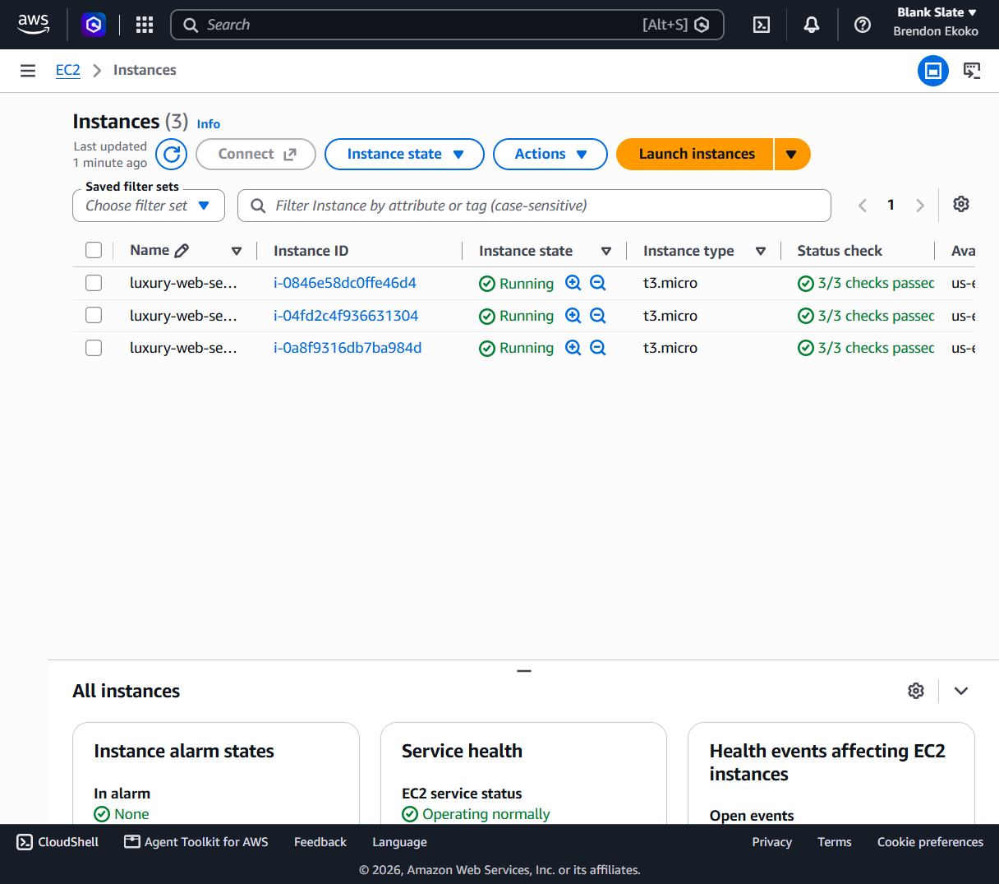
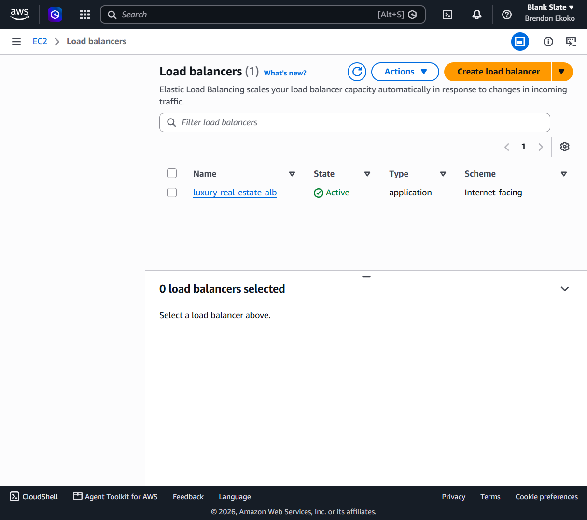
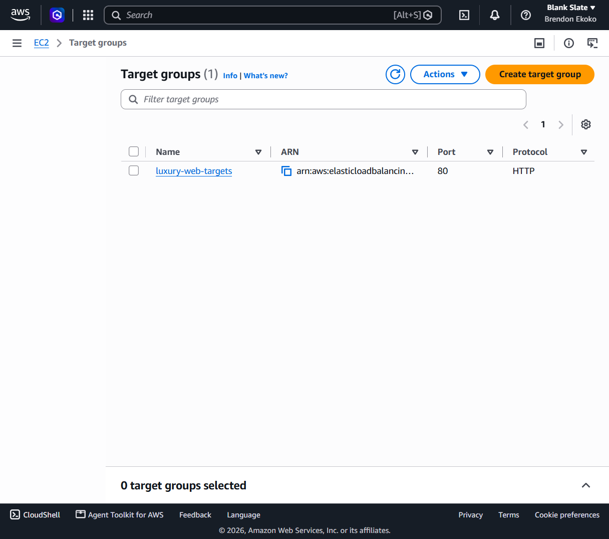
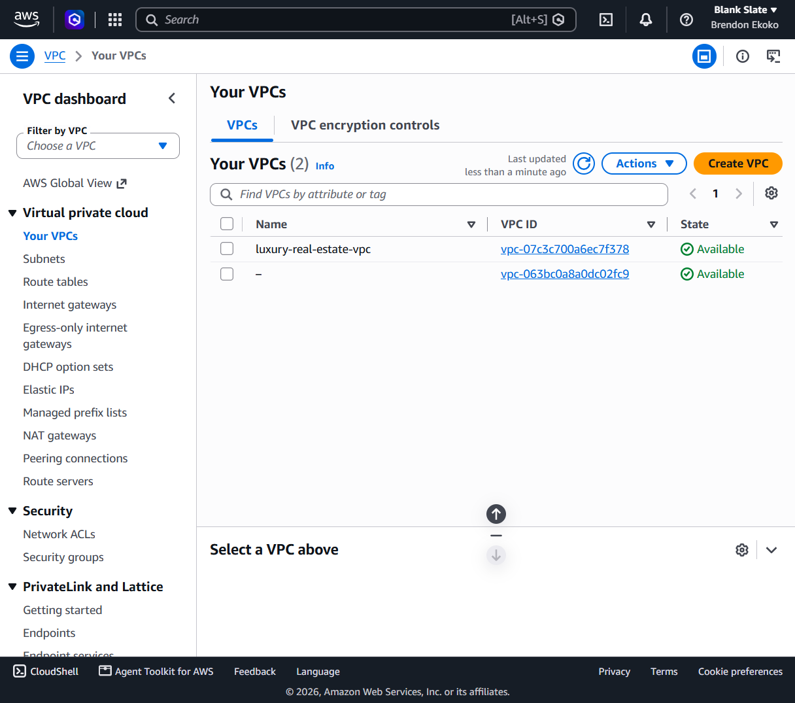
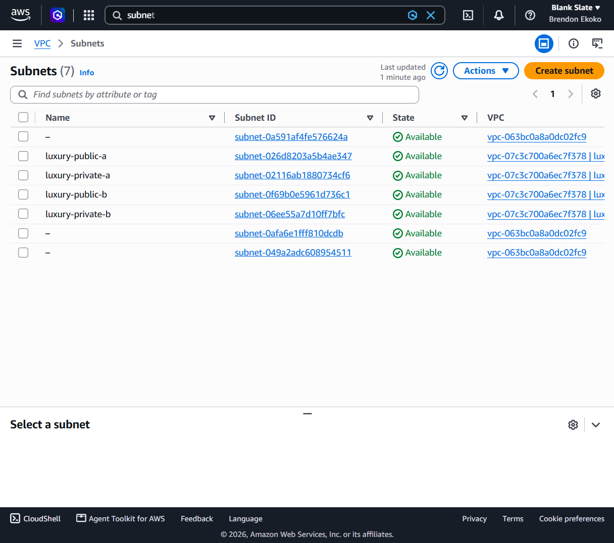
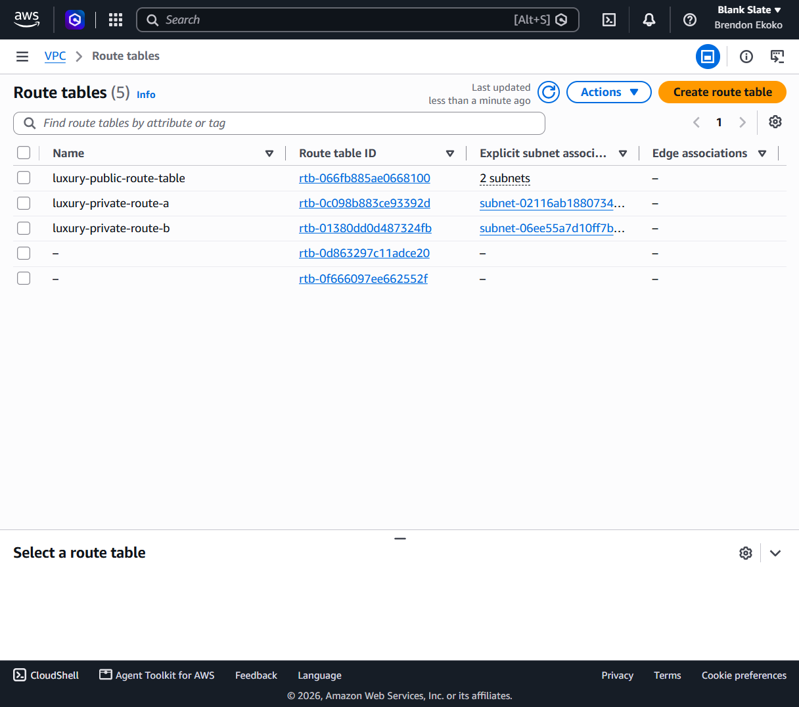
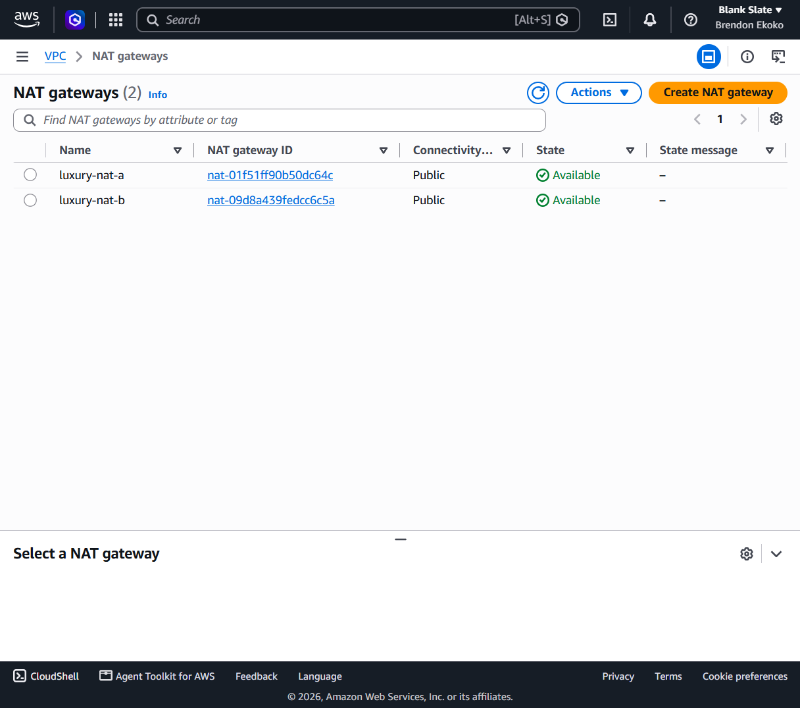
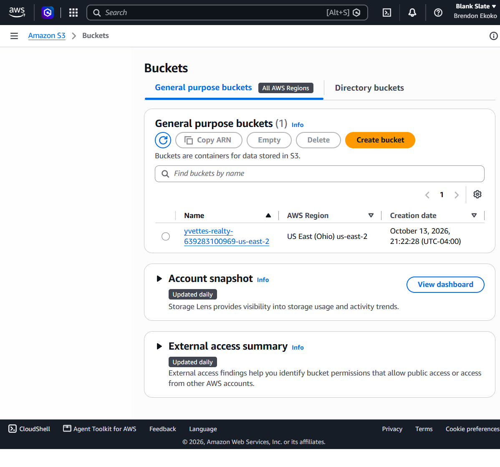
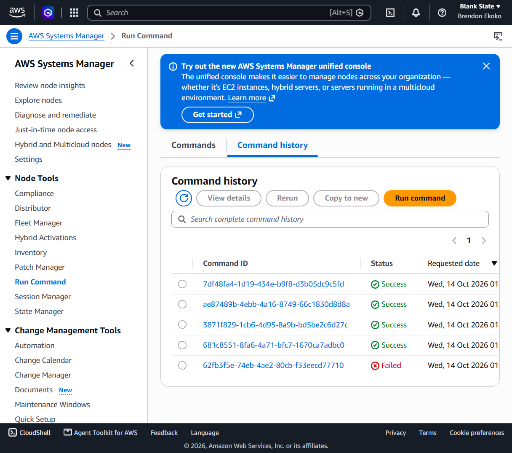

# AWS Cloud Infrastructure Project

Deployed a luxury real estate website using AWS and Terraform.

## Technologies
AWS EC2, VPC, ALB, NAT Gateway, S3, Systems Manager, Terraform, Linux, Bash.

## Project Highlights
- Provisioned cloud infrastructure using Terraform
- Configured public and private subnets
- Deployed three EC2 web servers
- Configured an Application Load Balancer
- Automated website deployment using AWS Systems Manager
- Stored deployment packages in Amazon S3
- Successfully destroyed 30 Terraform resources

## AWS Infrastructure Screenshots

The following screenshots document the AWS cloud infrastructure, networking configuration, automated deployment, and completed real estate website.

[View All Project Screenshots](./screenshots/)

## Project Screenshots

### Deployed Real Estate Website

### EC2 Web Servers

### Application Load Balancer

### Target Groups

### Virtual Private Cloud

### Public and Private Subnets

### Route Tables

### NAT Gateway

### Amazon S3 Bucket

### AWS Systems Manager

  
